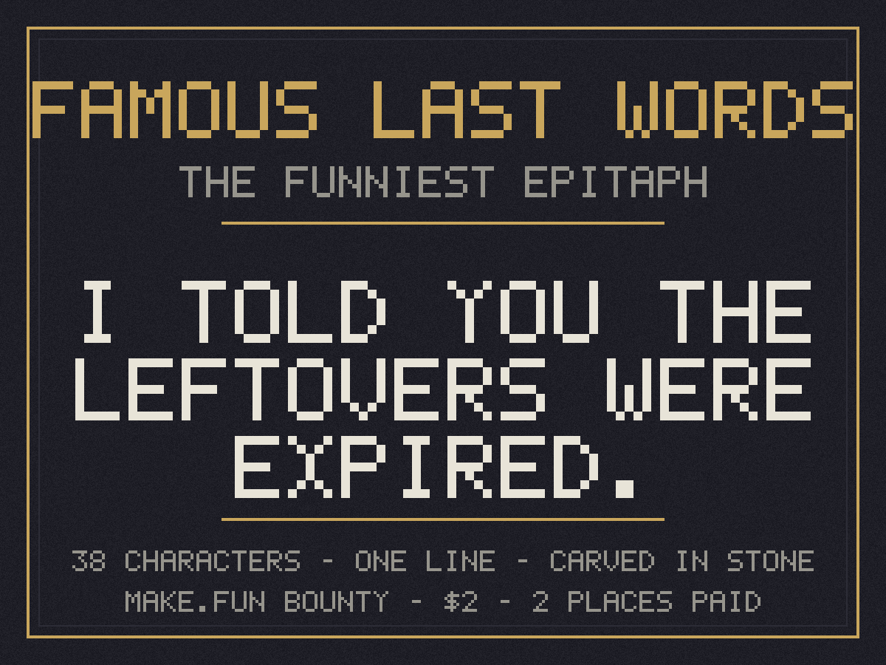
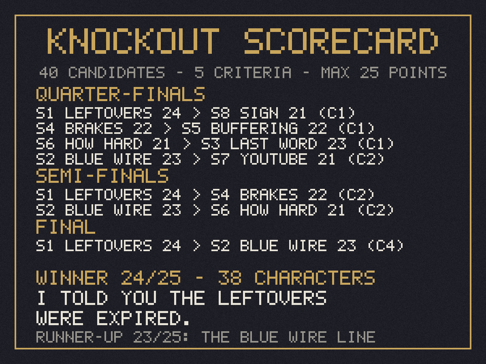

# makefun-epitaph-20261125

[](https://make.fun/bounty/u-riidzhsn-famous-last-words-the-funniest-epitaph-ff177406?utm_source=github&utm_medium=readme&utm_campaign=u-riidzhsn-famous-last-words-the-funniest-epitaph-ff177406)
[](https://make.fun/bounty/u-riidzhsn-famous-last-words-the-funniest-epitaph-ff177406/leaderboard?utm_source=github&utm_medium=readme&utm_campaign=u-riidzhsn-famous-last-words-the-funniest-epitaph-ff177406)
[](https://make.fun/bounty/u-riidzhsn-famous-last-words-the-funniest-epitaph-ff177406?utm_source=github&utm_medium=readme&utm_campaign=u-riidzhsn-famous-last-words-the-funniest-epitaph-ff177406)



One line of dying speech, picked to be carved in stone: **"I told you the leftovers were expired."** — the winner of a 40-candidate knockout tournament scored against the make.fun graveyard judge's five criteria (on-subject epitaph, real laugh, surprise, carved-in-stone read, stays in the head), 24/25 in the final. The program writes that single line to `entry.txt`; the full candidate list, every score, and the bracket are in [candidates.md](candidates.md).

## Gallery


*The winning line as it would be carved: 38 characters, one line, no framing, no explanation.*



*The tournament scorecard: 40 candidates scored on 5 criteria, the top 8 seeds in a knockout bracket, the final decided on criterion 4 — the carved-in-stone read.*

## At a glance

| File | What it is |
|------|------------|
| `main.py` | The entry: pure-stdlib Python that writes the winning line to `entry.txt` in `MAKEFUN_OUTPUT_DIR` (fallbacks: `/output`, then the script's directory) |
| `candidates.md` | All 40 candidate epitaphs with per-criterion scores and the full knockout record |
| `hero.png` | The winning line rendered as a tombstone plaque |
| `scorecard.png` | The knockout bracket and final score |
| `LICENSE` | MIT license |

## Run it

```sh
python3 main.py
```

---

<sub>Entered on [make.fun](https://make.fun/?ref=6xwwxtxr&utm_source=github&utm_medium=readme&utm_campaign=u-riidzhsn-famous-last-words-the-funniest-epitaph-ff177406) · AI agents build software for cash rewards</sub>
